UFCFWK-15-2 - Operating Systems Worksheet 2

Task 1 - Setting up a small operating system

Objective: The objective of this task was to create the basic structure of an operating system and get it to boot using GRUB in QEMU.

The linker script controls how the memory is arranged in the kernel, the kernel is only loaded at a certain address so that GRUB knows the expected location. The main part of the script is:

ENTRY(loader)

SECTIONS {
    . = 0x00100000;

    .text ALIGN (0x1000) :
    {
        *(.text)
    }

    .rodata ALIGN (0x1000) :
    {
        *(.rodata*)
    }

    .data ALIGN (0x1000) :
    {
        *(.data)
    }

    .bss ALIGN (0x1000) :
    {
        *(COMMON)
        *(.bss)
    }
}

The 0x100000 sets the starting address of the kernel to 1 MB. The different sections help with organisation.

The Assembly file is assembled into an object file using NASM. The linker then uses the object file and the linker script to produce the kernel.elf file. The main part of the Assembly file is:

global loader

MAGIC_NUMBER equ 0x1BADB002
FLAGS        equ 0x0
CHECKSUM     equ -MAGIC_NUMBER

section .text
align 4

dd MAGIC_NUMBER
dd FLAGS
dd CHECKSUM

loader:
    mov eax, 0xCAFEBABE

.loop:
    jmp .loop

The multiboot header contains the magic number, flags and the checksum. GRUb then recognises this kernel as a multiboot kernel. The loader places 0xCAFEBABE into the register and enters a loop.

The makefile automates the building process of the operating system, it contains instructions which include how to assemble, link and create the bootable ISO image.

The main commands used for the makefile are:

source/loader.o: source/loader.asm
    $(AS) -f elf source/loader.asm -o source/loader.o

kernel.elf: source/loader.o source/link.ld
    $(LD) -T source/link.ld -melf_i386 source/loader.o -o kernel.elf

The makefile also copies the kernel into the GRUB directory and uses genisoimage to package boot files into os.iso which is then used to boot the operating system in QEMU.

The makefile also contains a rule that starts the operating system in QEMU allowing the operating system to be tested without having to run the command manually.

GRUB is the bootloader to load the kernel into memory and start the operating system. GRUB uses the menu.lst file to find the kernel. The file stage2_eltorito provides the GRUB bootloader needed to boot the ISO image.

1. QEMU starts the virtual machine using the ISO file.

2. GRUB starts using the bootloader files included in the ISO.

3. GRUB reads the menu.lst file to find the kernel.

4. GRUB loads the kernel.elf into memory.

5. The Assembly loader begins executing.

6. The loader places 0xCAFEBABE into EAX and enters an infinite loop.

Testing Task 1

The operating system was built using the Makefile and successfully booted in QEMU.

The ISO loaded into the machine allowing GRUB to load the kernel.

The CPU log was checked to confirm that the EAX register contained 0xCAFEBABE. This showed that the Assembly loader had successfully executed.

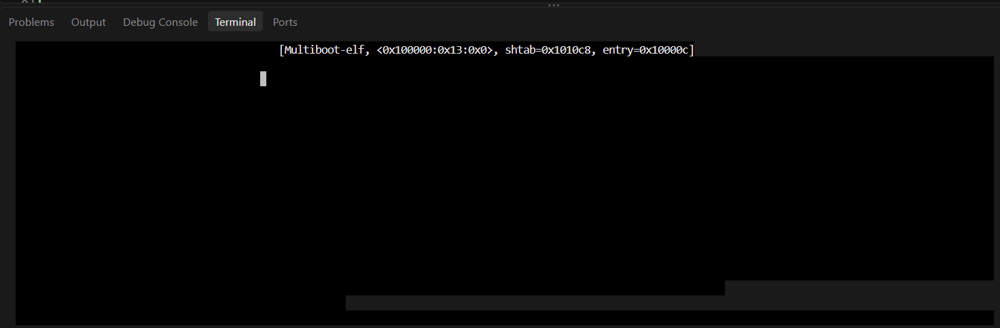
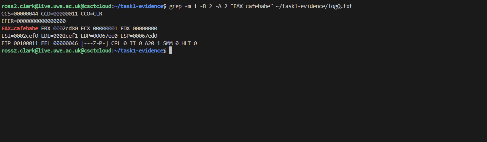

Task 2 - Calling C functions using assembly

Objective: The objective of this task was to call functions using assembly that have been written in the C language, This allows the code to use functions that are written in a different language.

The kernel.c file contains three functions which are sum_of_three, multiply_two and subtract_two. Each of these functions uses numbers as arguments and returns a result.

The main functions include:

int sum_of_three(int a, int b, int c)
{
    return a + b + c;
}

int multiply_two(int a, int b)
{
    return a * b;
}

int subtract_two(int a, int b)
{
    return a - b;
}

The loader calls these functions, the functions are declared as extern so that the code knows they are defined in another file. Assembly pushes the arguments onto the stack before calling each of the functions, the stack pointer is then adjusted to remove arguments.

Before C functions are enabled the assembly needs to set up a stack which is done by setting the ESP register to the address of the top of the stack.

The stack is used to store the arguments that pass the C functions. The stack pointer keeps track of the position in the stack.

The main part of the assembly for this task is:

; Call sum_of_three(1, 2, 3)
push dword 3
push dword 2
push dword 1
call sum_of_three
add esp, 12

; Call multiply_two(4, 5)
push dword 5
push dword 4
call multiply_two
add esp, 8

; Call subtract_two(10, 4)
push dword 4
push dword 10
call subtract_two
add esp, 8

The arguments are pushed onto the stack in reverse order before each function is called. The call instruction transfers control to the C function. When the function finishes, the result is returned in EAX. The add esp instructions adjust the stack pointer to remove the arguments that were pushed.

The functions calculate the following results:

Function

Calculation

Expected result

sum_of_three

1 + 2 + 3

6

multiply_two

4 × 5

20

subtract_two

10 - 4

6

The Makefile was also updated to compile the C file using GCC and link the resulting object file with the assembly object file to create the kernel.elf.

Testing Task 2

The operating system was built successfully, QEMU was used to boot the ISO and GRUB recognised the kernel.

The C functions were tested by checking the values returned in the EAX register. The sum of three function should return the value of 6, multiply_two should return 20 and the subtract two should return 6.

The results can be checked after the function call to confirm the code is correctly passing arguments to the C functions and then confirming the results.

The assembly code successfully reached the function calls and then entered a loop, the functions return their calculation results.

GDB was used to test the three C functions while the operating system was running. breakpoints were set for each function so that it would stop when the function is called. The finish command was used to return to the assembly loader.

The EAX register was checked to confirm that each function returned the expected result.

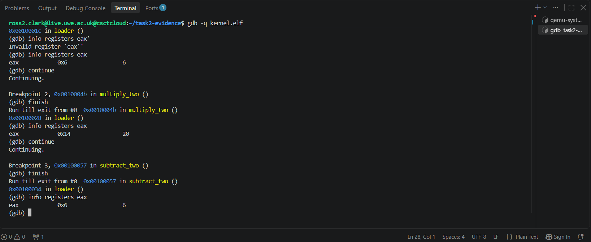
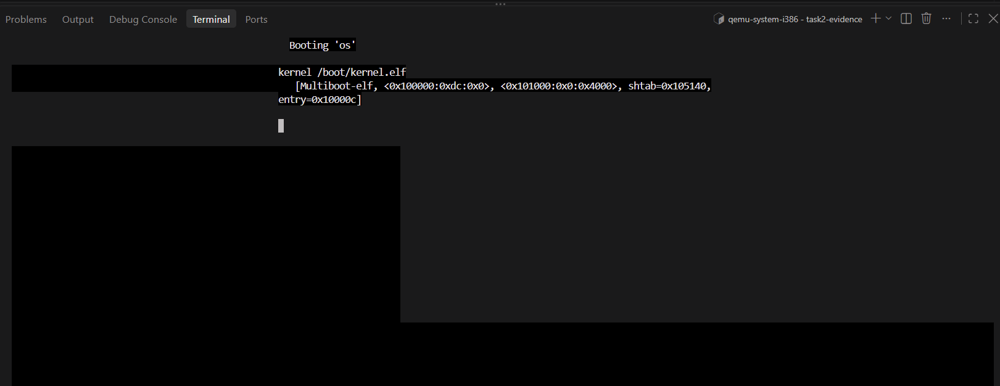
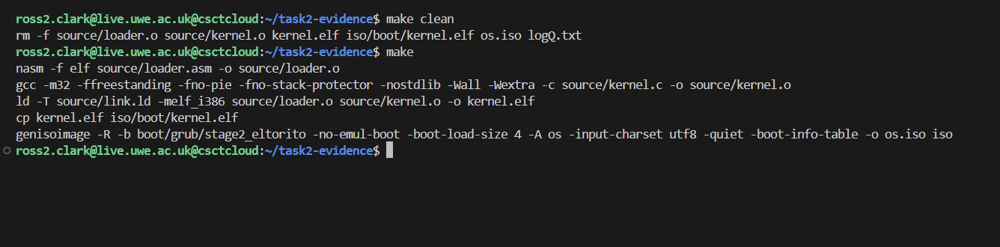

Task 3 - Developing a framebuffer

Objective: The objective of creating a framebuffer was to develop a driver for the operating system to display text on the screen. The framebuffer allows the operating system to output character by writing them directly to the memory allocation for video. The driver allows the cursor to be moved, to change the text colours and to clear the screen.

The framebuffer uses the video memory to display an output onto the screen, the memory address starts at 0xB8000, which is where the operating system can use character to display them.

Each character contains two bytes, the first byte stores the character and the second byte stores the colour which includes the foreground and the background colour.

For example writing the value of 0x0f41 to the framebuffer displays the letter A on a white background.

The framebuffer.c file contains the functions used to control the frambuffer, the address of the framebuffer and the dimensions are defined at the beginning of the C file.

#define FB_ADDRESS 0x000B8000
#define FB_WIDTH 80
#define FB_HEIGHT 25

static unsigned short *fb = (unsigned short *) FB_ADDRESS;

FB_ ADDRESS defines the framebuffer starting address. FB_WIDTH and FB_HEIGHT define the screen dimensions as 80 columns and 25 rows.

The pointer fb is used to access the memory of the frame buffer so characters can be written to the screen.

The fb_write_cell is the core help for writing an induvidual character to the framebuffer.

void fb_write_cell(unsigned int i, char c, unsigned char fg, unsigned char bg)
{
    fb[i] = (unsigned short)c | ((unsigned short)(fg | bg << 4) << 8);
}

The function takes the position of the character, the character itself and the foreground and background, combines the information into a value and then writes it to the framebuffer.

The fb_move function is used for the position of the next character which uses x and y coordinates to control different positions.

void fb_move(unsigned short x, unsigned short y)
{
    if (x >= FB_WIDTH || y >= FB_HEIGHT)
    {
        return;
    }

    cursor_x = x;
    cursor_y = y;
}

The function first checks whether the coordinates are in the dimensions of the screen specified above and then cursor x and cursor y are updated to a new position which allows text to be displayed at different places on the screen.

The fb write function displays strings to the text of the screen, it reads each character in the string and writes it to the framebuffer.

void fb_write(char *buf)
{
    unsigned int i = 0;

    while (buf[i] != '\0')
    {
        if (buf[i] == '\n')
        {
            cursor_x = 0;
            cursor_y++;
        }
        else
        {
            fb_write_cell(cursor_y * FB_WIDTH + cursor_x,
                          buf[i], text_colour & 0x0F,
                          (text_colour >> 4) & 0x0F);

            cursor_x++;
        }

        i++;
    }
}

The function uses a while loop to go through the characters until it reches the end, if the character is a new line it will move to the beginning of the next row.

fb_write_cell is called to write the character to the framebuffer using the current text colour.

The cursor position increases with each character so that the next character is in the correct position, the full function also includes a check to see if the cursor reaches the edge of the screen.

The fb_set_colour function is used to change the foregorund and background of the text displayed.

void fb_set_colour(unsigned char fg, unsigned char bg)
{
    text_colour = fg | (bg << 4);
}

The function takes two different arguments which are fg and bg, fg is for foreground and bg is for background.

The background colour is moved four bits to the elft and then combined with the foreground colour.

The combined value is stored in text_colour.

The fb_clear function is used to clear the framebuffer by replacing all the characters with blank spaces that are on the screen.

void fb_clear()
{
    unsigned int i;

    for (i = 0; i < FB_WIDTH * FB_HEIGHT; i++)
    {
        fb_write_cell(i, ' ', 15, 0);
    }

    cursor_x = 0;
    cursor_y = 0;
}

This function uses a for loop to go through every single position in the framebuffer which is 2000 positions. 

The fb_write_cell function writes a blank space for each position, once the screen is cleared the cursors are reset to 0 so that the enxt character is written at the top left corner of the screen.

The fb_write_number function is used for displaying integers on the screen. since the function fb_write is used to display strings we need to convert the numbers into characters.

while (value > 0)
{
    buffer[i++] = '0' + (value % 10);
    value /= 10;
}

while (i > 0)
{
    char digit[2];
    digit[0] = buffer[--i];
    digit[1] = '\0';
    fb_write(digit);
}

The first while loop deperates the number into digits using the modulus operator, each digit is converted into a character and then stored in the buffer. The digits are stored in the reverse order so that the second while loop reads the buffer backwards and uses the fb_write function to display in the correct order.

There are two ways that the operating system can communicate with hardware, memory mapped I/O and I/O ports.

Memory-mapped I/O allows the operating system to talk to the hardware by reading to specific addresses, the framebuffer uses this method because character are displayed to the memory address.

I/O ports are another way of communicating with hardware. They use assembly instructions such as in and out to read and write data through specific ports.

The Makefile was updated to compile the framebuffer alongside the assembly and the kernel.

The rule was added: drivers/framebuffer.o: drivers/framebuffer.c drivers/framebuffer.h
	$(CC) $(CFLAGS) -c drivers/framebuffer.c -o drivers/framebuffer.o

This rule uses GCC to compile framebuffer.c into an object file called framebuffer.o, The framebuffer.h file is a depenfancy so that changes to the header file will cause the driver to be recompiled.

The linker rule also updated to include the framebuffer.o file alongside loader.o and kernel.o.

Testing Task 3

The operating system was tested using QEMU in curses mode which allows the framebuffer to output into the terminal, the Makefile includes this command:

run: os.iso
	$(QEMU) -display curses -monitor telnet::45454,server,nowait -serial mon:stdio -boot d -cdrom os.iso -m 32

The display curses option allows QEMU to display the operating systems text output in the terminal.

The -monitor telnet::45454,server,nowait option starts a Telnet monitor on port 45454. This allows QEMU to be controlled from another terminal.

A second terminal was used to connect to the monitor using localhost 45454.

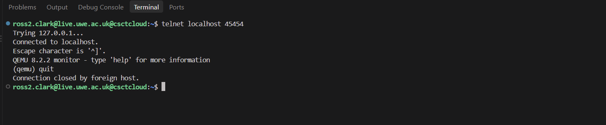
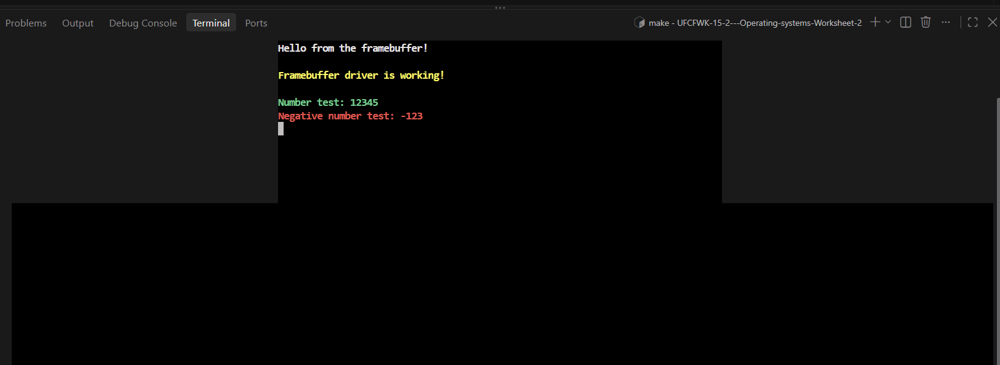

Worksheet 2 Part 2 - inputting and interupts

Task 1: - Display keyboard inputs

Objective:

The objective of this task was to add on to the existing operating system be allowing keyboard inputs using hardware interrupts. Once this task had been completed the operating system should be able to display characters, use backspaces and move to a new line.

Implementations:

I created a io.asm and io.h file to allow the operating system to talk to the hardware through I/O ports, the inb function reads a byte from a port and the outb writes a byte to the port.

I then created a pic.c and .h file to configure a interrupt controller. The PIC remap function rempas the interrupts and pic_acknowledge tells the PIC when an interrupt has been handled.

I created the interrupt handling files to set up the interrupt descriptor table which allows the operating system to respond to the hardware interrupts, the keyboard input uses interrupt 33.

I also created a keybaord.c and keybaord.h to read keyboard scan codes and convert them, into ASCII.

I also updated the framebuffer driver to support displaying individual charcater, remove characters and move to a new line.

Finally I updated the kernel.c to initialise the interrupt system and enable hardware interrupts. The makefule was also updated to compile the new files.

Testing:

I used the following commands to build the system:
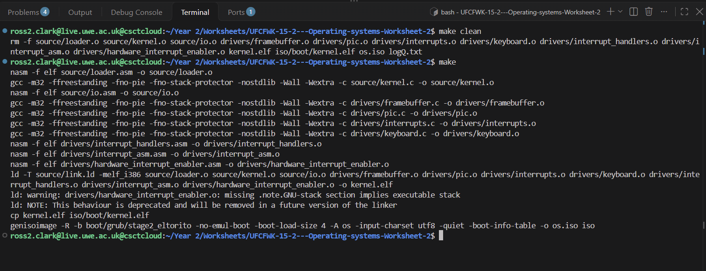
I then ran the system and tested the keyboard inputs:
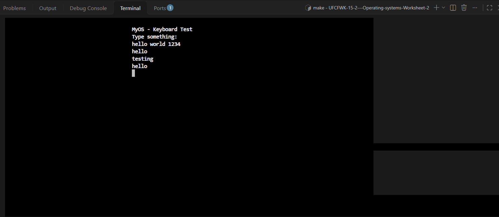

Result: the operating system successfully recieved keyboard inputs through the interrupts and displayed the characters using the driver, backspace and enter were also tested and worked successfully.

Task 2 - Input Buffer API

Objective:

The objective of this task was to create an input buffer that allows the operating system to retrieve and store keyboard input, the system reads individual characters and completes lines of text.

Implementation:

I used a buffer in interrupts.c to store the characters from the keyboard, the buffer has a maximum size of 256 bytes.

The getc() function retrieves a character from the buffer and then removes it, if the buffer is empty the function returnd -1.

I then created input.c and input.h to implement the function readline() which uses getc() to get characters until the enter key is pressed.

The readline() functiono stores the characters in the buffer, it also handles backspace by removing the previous character from the input and checks the buffer size to prevent writing outside of the allocated memory.

I also updated the kernel.c to test the input functions by allowing the user ot enter text and then repeating the text on the screen.

I also updated the Makefule to compile the new input files.

I then ran the operating system using make run and tested tghe input buffer by entering different characters, I tested hello world and 123, the operating system displayed the entered text back correctly.

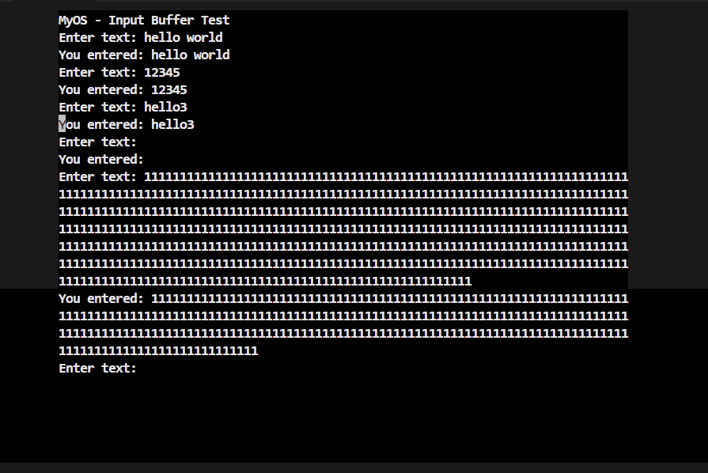
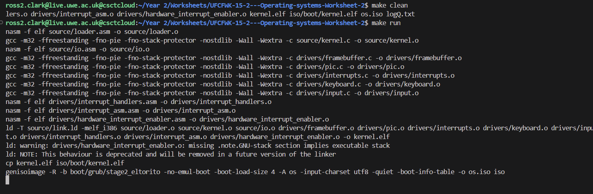

The operating system successfully stored and retrieved keyboard characters using the input buffer. 

Task 3:

Objective:

The objective of this task was to create a basic terminal for the operating system that allows users to enter commands similar to a basic unix system.

Implementation:

I created two new files called terminal.c and terminal.h inside the drivers folder, the terminal.h file contains the declration for the terminal_run() function while terminal.c has the code for running the temrinal and processing the different commands.

The terminal_run() function displays a welcome message and allows the user to enter commands, it also uses readline() from task 2 to recieve keyboard inputs.

I created the process_command function to seperate the command name from its arguments, the function then compares the entered command against the ones stored in the command table.

The four commands I implemented were:

1. Help - Displays the list of available commands
2. Echo - Displays the text entered after the command
3. Clear - Clears the screen
4. Version - Displays the current operating system version

The command table uses a structure to store the names and function pointers. 

If the user enters a command that doesnt exist then the terminal will display an unknown command message.

I updated kernel.c to call terminal_run()
after initialising the interrupt system.

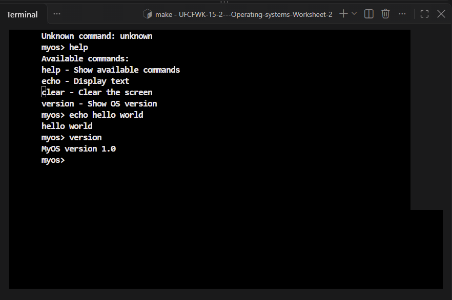
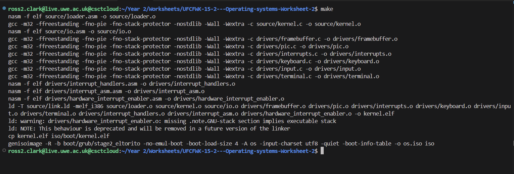

Result:

The terminal started and displayed the commands correctly, the terminal was able to receive keyboard input and process commands, the command table allows additional commands to be added to the operating system without changing the main temrinal loop.